# Agent Warden

> **This is a sample.** Agent Warden demonstrates the art of the possible with the [Microsoft Graph Package Management API](https://learn.microsoft.com/en-us/microsoft-365/copilot/extensibility/api/admin-settings/package/overview) write operations. It is a reference implementation and starting point, not a production-ready governance tool.

**Agent Warden** is a declarative agent for Microsoft 365 Copilot that lets IT admins and governance teams **take action** on the custom Copilot agents in their tenant. It reads the agent inventory from a **SharePoint list** (the same `Agents` list populated by the [agent-sync-sharepoint](../agent-sync-sharepoint/) sample) and makes governance changes — **blocking** agents and **reassigning availability and deployment** — through the Package Management API.

It is the action-taking companion to [Agent Steward](../agent-steward/), which focuses on read-only discovery, classification, and analysis.

---

## What it does

- **Read inventory from a list** — Uses the `Agents` SharePoint list as a grounded knowledge source for the custom-agent inventory (name, `Agent Id`, agent type, owner, blocked status, availability, deployment). It does **not** enumerate the tenant catalog directly.
- **Source usage data from the Insights Agent** — Connects to the native Microsoft **Insights Agent** (as a connected agent) for usage and adoption figures — active users, responses sent, and last activity — to inform duplicate severity and consolidation recommendations.
- **Block / unblock agents** — Sets an agent's blocked state via the Package Management API.
- **Reassign availability** — Changes who an agent is *available to* (`allowedUsersAndGroups`).
- **Reassign deployment** — Changes who an agent is *deployed to* (`acquireUsersAndGroups`).
- **Write results back to the list** — After a successful action, updates the agent's row in the `Agents` list (`Blocked`, `Available To`, `Deployed To`) so the inventory stays accurate.
- **Resolve people and groups** — Looks up users and groups by name to build a reassignment, and resolves IDs back to friendly names for clear before/after summaries.
- **Confirm before acting** — Always states the exact change and asks for explicit confirmation before any write.

## How it works

```mermaid
flowchart LR
    A[Admin in M365 Copilot] --> B[Agent Warden]
    B -- reads inventory --> C[(Agents SharePoint list)]
    B -- reads usage --> F[Insights Agent<br/>connected agent]
    B -- block / reassign --> D[Package Management API<br/>PATCH /packages/&#123;id&#125;]
    B -- resolve names/ids --> E[Microsoft Graph<br/>users / groups / directoryObjects]
```



The `Agents` list is kept up to date by the [agent-sync-sharepoint](../agent-sync-sharepoint/) sample. Agent Warden reads from it for inventory, sources usage data from the connected **Insights Agent**, and uses the API plugin only for write actions and directory lookups.

## Sample prompts

- 🔎 *Summarise the custom agents in the inventory, grouped by agent type.*
- � *Identify common themes and potential duplicate agents so I can decide what to block or consolidate.*
- 🔀 *Which agents serve the same purpose and could be consolidated, and what action would you recommend for each?*
- 📊 *Which agents are available or deployed to everyone in the tenant?*
- �🚫 *Which agents are currently blocked?*
- 🔒 *Block the Contoso Learning Coach agent.*
- 👥 *Make the Leave Agent available only to the HR group.*
- 🌐 *Deploy the Employee Self-Service HR agent to everyone.*
- 🧾 *Show the current availability and deployment for the Leave Agent.*

---

## Prerequisites

- [Microsoft 365 Agents Toolkit VS Code Extension](https://aka.ms/teams-toolkit) version 5.0.0 or higher
- A Microsoft 365 tenant with [Microsoft 365 Copilot licences](https://learn.microsoft.com/microsoft-365-copilot/extensibility/prerequisites#prerequisites)
- Access to the Package Management API — requires a Microsoft Agent 365 license
- The **`Agents` SharePoint list** populated by the [agent-sync-sharepoint](../agent-sync-sharepoint/) sample
- Access to the native Microsoft **Insights Agent** in your tenant (the connected agent Agent Warden uses for usage data)
- Users of the agent must hold the **Global Administrator** or **AI Administrator** role — the Package Management **write** endpoints support **delegated authentication only**, so calls are made as the signed-in user

> **Delegated only.** The [Update Copilot package](https://learn.microsoft.com/en-us/microsoft-365/copilot/extensibility/api/admin-settings/package/copilotpackagedetail-update) endpoint is available with the delegated `CopilotPackages.ReadWrite.All` permission only (application permissions are not available). Agent Warden therefore acts as the signed-in admin.

---

## Setup and deployment

### 1. Clone the repository

```bash
git clone https://github.com/microsoft/copilot-agent-inventory-samples.git
cd copilot-agent-inventory-samples/samples/agent-warden
```

### 2. Point the agent at the Agents list

Agent Warden reads inventory from the `Agents` SharePoint list as a knowledge source.

1. Make sure the [agent-sync-sharepoint](../agent-sync-sharepoint/) sample has been run so the `Agents` list is populated.
2. Open **env/env.dev.user** (gitignored) and set `SHAREPOINT_AGENTS_LIST_URL` to the list URL:

   ```
   SHAREPOINT_AGENTS_LIST_URL=https://<your-tenant>.sharepoint.com/sites/<your-site>/Lists/Agents
   ```

   > The Agents Toolkit substitutes this value into `declarativeAgent.json` at build time.

3. **For write-back** (updating the list after an action), the agent needs the Graph **site id** and **list id**. Set them in **env/env.dev.user** (gitignored); the Agents Toolkit substitutes them into `openapi.yaml` at build time:

   ```
   SHAREPOINT_AGENTS_SITE_ID=<tenant>.sharepoint.com,<site-collection-id>,<web-id>
   SHAREPOINT_AGENTS_LIST_ID=<list-guid>
   ```

   - Site id — `GET https://graph.microsoft.com/v1.0/sites/<tenant>.sharepoint.com:/sites/<your-site>` → `id`
   - List id — `GET https://graph.microsoft.com/v1.0/sites/<site-id>/lists?$filter=displayName eq 'Agents'` → `value[0].id`
4. Index the **Agent Id** column so write-back lookups (`$filter`) work: in the list, open **Agent Id** column settings and ensure it is indexed (List settings > Indexed columns), or the sample script/PnP `Set-PnPField -List Agents -Identity AgentId -Values @{ Indexed = $true }`.

> **Usage data via the connected Insights Agent.** Agent Warden is configured with the native Microsoft **Insights Agent** as a connected agent (declared in the `worker_agents` array of [appPackage/declarativeAgent.json](appPackage/declarativeAgent.json)) to source usage and adoption figures. No extra configuration is required — users of Agent Warden need access to the Insights Agent in their tenant for usage-based analysis. Without it, inventory, blocking, and reassignment still work; usage-informed severity just won't be available.

### 3. Configure OAuth for the API plugin

The API plugin calls the Package Management **write** endpoint and Microsoft Graph directory lookups using OAuth via the `OAuthPluginVault` auth type. Register an OAuth configuration in the Teams Developer Portal and store the resulting registration ID in your local env file.

1. Register (or reuse) an application in [Entra ID](https://entra.microsoft.com) and add the following **delegated** Microsoft Graph permissions, then grant admin consent:
   - `CopilotPackages.ReadWrite.All` — block and reassign agents
   - `Sites.Selected` — write action outcomes back to the Agents list, scoped to only the granted site (least privilege). Alternatively `Sites.ReadWrite.All` allows writing to any site the signed-in admin can access.
   - `User.Read.All`, `Group.Read.All`, `Directory.Read.All` — resolve users and groups

   Copy the **Client ID**.
2. In the same app registration, go to **Authentication** > **Add a platform** > **Web** and add the redirect URI: `https://teams.microsoft.com/api/platform/v1.0/oAuthRedirect`
3. Generate a client secret and copy the **Value**.
4. Open the [Teams Developer Portal](https://dev.teams.microsoft.com) and go to **Tools** > **OAuth client registration** > **New OAuth client registration**:
   - **Registration name** — e.g. `Agent Warden`
   - **Base URL** — `https://graph.microsoft.com`
   - **Client ID** — from step 1
   - **Client secret** — from step 3
   - **Authorization endpoint** — `https://login.microsoftonline.com/<your-tenant-id>/oauth2/v2.0/authorize`
   - **Token endpoint** — `https://login.microsoftonline.com/<your-tenant-id>/oauth2/v2.0/token`
   - **Refresh endpoint** — `https://login.microsoftonline.com/<your-tenant-id>/oauth2/v2.0/refresh`
   - **Scopes** — `CopilotPackages.ReadWrite.All Sites.Selected User.Read.All Group.Read.All Directory.Read.All offline_access`

   > **Least privilege for the list write-back.** With `Sites.Selected`, the plugin can only touch sites explicitly granted to its app. Grant it **Write** on just the Agents site (run as a SharePoint admin, replacing the app id and site URL):
   >
   > ```powershell
   > Grant-PnPAzureADAppSitePermission -AppId <warden-app-client-id> -DisplayName "Agent Warden" -Site https://<tenant>.sharepoint.com/sites/<your-site> -Permissions Write
   > ```
   >
   > Because the plugin uses **delegated** auth, every call already runs as the signed-in admin and is bounded by their SharePoint permissions; `Sites.Selected` narrows it further to this one site. Use `Sites.ReadWrite.All` instead only if you don't want to manage a per-site grant.

   > **The Base URL must be version-less — exactly `https://graph.microsoft.com`, with no `/v1.0` or `/beta` suffix.** It must match the `servers.url` in [openapi.yaml](appPackage/apiSpecificationFile/openapi.yaml), which is version-less; the API version (`/beta`) is carried in each path instead. A versioned base URL (e.g. `.../v1.0`) cannot reach the beta write endpoints and causes a `TokenFetchFailed` / "base URL does not match the server URL" error. A single version-less registration covers both the beta write calls and the v1.0-style directory lookups — you do **not** need a second registration or plugin.

   > Replace `<your-tenant-id>` with your Entra ID tenant ID. Using tenant-specific endpoints rather than `/common` is required for the Teams OAuth flow.
5. Save the registration and copy the **OAuth registration ID**.
6. Open **env/env.dev.user** and set the reference ID:

   ```
   OAUTH_PLUGIN_VAULT_REFERENCE_ID=<your-reference-id>
   ```

### 4. Deploy with Microsoft 365 Agents Toolkit

1. Open the `samples/agent-warden` folder in VS Code.
2. Select the **Microsoft 365 Agents Toolkit** icon in the activity bar.
3. Sign in with your Microsoft 365 account in the **Accounts** section.
4. Select **Provision** to register the app in your tenant.
5. Open [Microsoft 365 Copilot](https://m365.cloud.microsoft/chat) and find **Agent Warden** in the agent list.

---

## Safety model

Agent Warden makes changes to live agents, so its instructions enforce a confirmation-first workflow:

- It **never** blocks, unblocks, or reassigns without explicit confirmation for that specific action.
- Before acting it states the agent, the action, and the resolved user/group **names** (not just IDs), and shows a **before/after** audience for reassignments.
- Because `allowedUsersAndGroups` / `acquireUsersAndGroups` updates **replace** the whole collection, it reads current state first so nothing is unintentionally removed.
- A successful write returns **HTTP 204**; the agent confirms the outcome and can re-read the agent to show the new state.

---

## Customisation

- **Instructions** — Edit [appPackage/instruction.txt](appPackage/instruction.txt) to adjust the confirmation workflow, output style, or supported actions.
- **Conversation starters** — Edit the `conversation_starters` array in [appPackage/declarativeAgent.json](appPackage/declarativeAgent.json).
- **Actions** — Edit [appPackage/ai-plugin.json](appPackage/ai-plugin.json) and [appPackage/apiSpecificationFile/openapi.yaml](appPackage/apiSpecificationFile/openapi.yaml) to add or refine operations.

---

## References

- [Update Copilot package (Package Management API)](https://learn.microsoft.com/en-us/microsoft-365/copilot/extensibility/api/admin-settings/package/copilotpackagedetail-update)
- [Microsoft Graph Package Management API](https://learn.microsoft.com/en-us/microsoft-365/copilot/extensibility/api/admin-settings/package/overview)
- [Declarative agents for Microsoft 365](https://aka.ms/teams-toolkit-declarative-agent)
- [Extend Microsoft 365 Copilot with API plugins](https://learn.microsoft.com/microsoft-365-copilot/extensibility/overview-api-plugin)
- [agent-sync-sharepoint sample](../agent-sync-sharepoint/) — populates the `Agents` list
- [agent-steward sample](../agent-steward/) — read-only discovery and analysis

---

## Licence

MIT — see [LICENSE](../../LICENSE) for details.

> **Note:** This sample is community-maintained and is not covered by a Microsoft support SLA.
